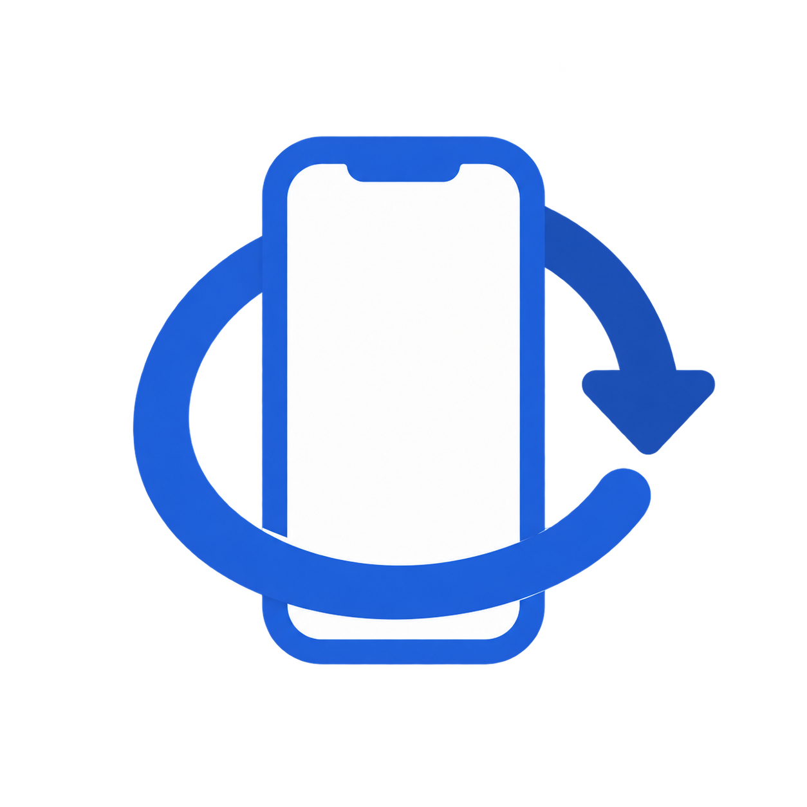
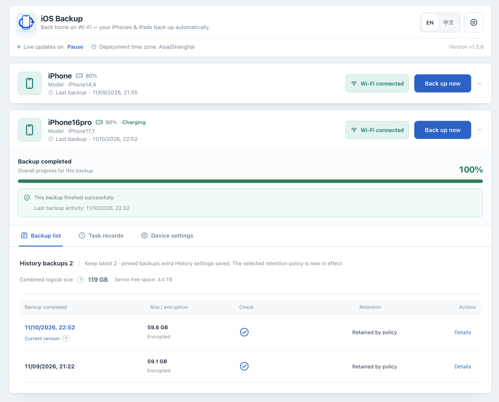

<p align="center">
  
</p>

<h1 align="center">iOS Backup</h1>

<p align="center">
  <strong>Back home on Wi-Fi — your iPhone and iPad back up automatically.</strong>
</p>

<p align="center">
  <a href="#quick-start">Quick start</a> ·
  <a href="docs/OPERATIONS.md">Documentation</a> ·
  <a href="#troubleshooting">Troubleshooting</a> ·
  <a href="CHANGELOG.md">Changelog</a>
</p>

<p align="center">
  English · <a href="README.zh-CN.md">简体中文</a>
</p>

<p align="center">
  
</p>

<p align="center">
  <sub>English console · Wi-Fi devices, backup progress, and backup history.</sub>
</p>

iOS Backup lets you back up an iPhone or iPad to your own Linux host or NAS through a browser. It is designed for one administrator and runs libimobiledevice, usbmuxd2, and netmuxd in a privileged container. It supports USB device discovery, scheduled backups, read-only backup inspection, and optional notifications.

## Quick start

You need a Linux host or NAS with Docker Engine and Docker Compose, an iPhone/iPad whose passcode you know, a USB data cable, and enough disk space for a complete device backup. For Synology DSM, use the [Synology guide](docs/manual/synology.md). For an existing deployment, follow [upgrade and rollback](#upgrade-and-rollback).

**1. Start the service**

Download [compose.yaml](compose.yaml) into a new deployment directory on your Linux host, then start the container:

```bash
mkdir -p "$HOME/iosbackup-deploy"
cd "$HOME/iosbackup-deploy"
curl -fL https://raw.githubusercontent.com/razeencheng/iosbackup/main/compose.yaml -o compose.yaml
docker compose up -d
docker compose logs iosbackup
```

Compose defaults to the official image `ghcr.io/razeencheng/iosbackup:latest` and port `9000`.

**2. Sign in**

Open `http://<Linux-host>:9000/` and sign in with the administrator password shown in the first-start log. The password and encryption master key are generated automatically and saved in `data/configs`; restarts and upgrades reuse them. Do not share the first-start log.

**3. Complete your first backup**

Connect the iPhone or iPad to your Linux host over USB, unlock it, and tap **Trust** when prompted. Follow the setup wizard, confirm the device shows **USB**, and click **Back up now**. After a successful USB backup, follow the [Wi-Fi guide](docs/manual/wifi.md) to enable wireless backups, then configure [automatic schedules](docs/manual/scheduling.md).

See the [illustrated quick start](docs/QUICKSTART.md) for the full sign-in, pairing, and backup walkthrough, or the [installation guide](docs/manual/installation.md) for advanced setup.

Keep all three persistent directories: `data/backups` (device backups), `data/configs` (settings, passwords, default `secret_key`, and encrypted secrets), and `data/lockdown` (pairing records). Back up these before upgrades, plus Compose configuration and external credentials in use. Protect the administrator password and keep the master key used for stored secrets unchanged.

## Feature status

- **Core:** USB discovery and pairing, manual and scheduled backups, Wi-Fi backups, and backup encryption enable/disable/change-password workflows.
- **Experimental, disabled by default:** whole-device restore, local unpack, and local backup deletion. See [Feature status](docs/FEATURE_STATUS.md) before enabling any of them.

The local Web UI has no telemetry or remote frontend assets. Optional Telegram, SMTP, WeCom, Bark, and webhook notifications make outbound requests only after an administrator configures them. Built-in authentication is intended for a single administrator.

The application is distributed as a Linux container for `linux/amd64` and `linux/arm64`. Native device operation on Windows or macOS is not promised. The Go module itself uses only the standard library, but the running application still depends on the libimobiledevice/netmuxd toolchain included in the image.

The container requires `--privileged`, `--network host`, `/dev/bus/usb:/dev/bus/usb`, and `/run/udev:/run/udev:ro`. **Privileged mode grants host-level access. We recommend running it only on a trusted host and trusted network. Do not expose the Web UI directly to the public Internet.** Even with authentication enabled, a firewall, VPN, or authenticated HTTPS reverse proxy is still recommended.

## Upgrade and rollback

Back up `data/backups`, `data/configs`, `data/lockdown`, Compose configuration, and external credentials first. With the default `latest` image, run `docker compose pull` and `docker compose up -d` to download and run the new image. If you pinned a version, change Compose's `image` back to `ghcr.io/razeencheng/iosbackup:latest`. Verify `/healthz`, `/api/version`, logs, pairing, and a complete USB backup on a non-critical device.

Before rollback, follow the [rollback steps](docs/manual/upgrade.md#rollback-steps) to confirm that the target version can read the current data and configuration, then change Compose's `image` and recreate the container. Do not roll back persisted data blindly: restore the volume snapshot only when the release notes say the on-disk format is incompatible. Use the recorded old version tag or digest for rollback; the mutable `latest` tag cannot identify an old version.

See [Operations](docs/OPERATIONS.md) for the full upgrade, rollback, volume-backup, and log procedures.

## Troubleshooting

- **No device:** reconnect USB, respond to any device passcode prompt or unlock it and tap **Trust** , verify the USB and udev mounts, then refresh.
- **`mobilebackup2 (-4)` or Wi-Fi disconnect:** reconnect the device, retry over USB, check for phone authorization prompts, and verify the network connection.
- **Locked-device/passcode error:** when USB is connected or a backup wakes the phone, enter its device passcode if a white passcode screen appears. If a trust prompt appears, unlock the phone and tap **Trust** . There is no need to keep the phone unlocked or its screen on.
- **No space/read-only/permission denied:** check free space and host permissions for `data/backups`, `data/configs`, and `data/lockdown`.
- **Container starts but UI is unavailable:** check `docker compose logs --tail=200 iosbackup` and `curl -fsS --retry 12 --retry-connrefused --retry-delay 5 --retry-max-time 90 http://127.0.0.1:9000/healthz`.

See [Operations](docs/OPERATIONS.md) for detailed troubleshooting.

## Documentation

- [Quick start](docs/QUICKSTART.md)
- [Operations manual](docs/OPERATIONS.md)
- [Linux installation](docs/manual/installation.md) · [Synology DSM](docs/manual/synology.md)
- [Configuration reference](docs/manual/configuration.md) · [Development guide](docs/DEVELOPMENT.md)
- [Feature status](docs/FEATURE_STATUS.md)
- [Notification guide](docs/manual/notifications.md)
- [Webhook guide](docs/WEBHOOK_GUIDE.en.md)
- [Privacy](docs/PRIVACY.md)
- [Security policy](SECURITY.md)
- [Support policy](SUPPORT.md)
- [Changelog](CHANGELOG.md)

## Version history

v1.5.6 fixes history imports with large metadata, adds a configurable plist parsing limit, improves failed-import retry and diagnostics, and preserves complete online CSV records. See the [release notes](CHANGELOG.md#v156).

v1.5.5 adds backup history, complete exports, offline browsing and checks, with improved backup controls, localization, notifications, and deployment timezone support. See the [release notes](CHANGELOG.md#v155).

See the [Changelog](CHANGELOG.md) for the latest changes, historical releases, and compatibility notes.

## Development and contributions

The program starts in `cmd/iosbackup`; `internal/app` coordinates the application, with individual functions implemented in separate packages. A local source build still needs the external device tools at runtime:

```bash
go test -count=1 ./...
go vet ./...
CGO_ENABLED=0 go build -trimpath -o iosbackup ./cmd/iosbackup
```

Contributions are licensed inbound = outbound under `AGPL-3.0-only`; no CLA, DCO, or `Signed-off-by` is required. See [CONTRIBUTING.md](CONTRIBUTING.md).

## License and trademarks

Project source is licensed under [GNU AGPL v3.0 only](LICENSE), SPDX `AGPL-3.0-only`. Container components keep their own licenses; see [Licensing](docs/LICENSING.md) and [Third-party notices](THIRD_PARTY_NOTICES.md).

Copyright (C) 2025-2026 Razeen Cheng. This project is not affiliated with, sponsored by, or endorsed by Apple Inc. See [TRADEMARKS.md](TRADEMARKS.md).
