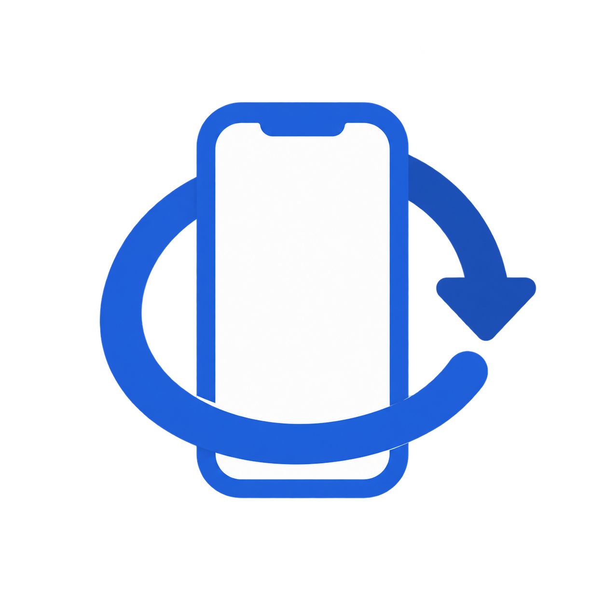
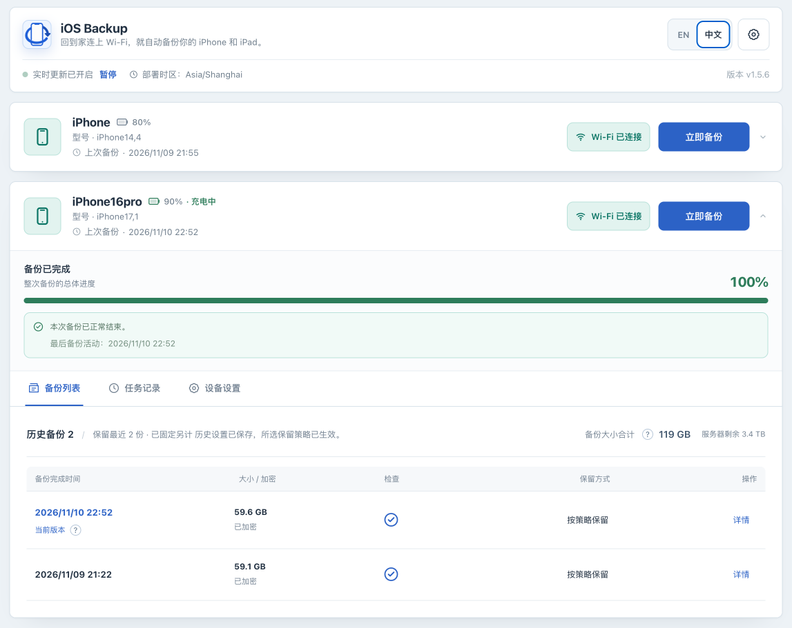

<p align="center">
  
</p>

<h1 align="center">iOS Backup</h1>

<p align="center">
  <strong>回到家连上 Wi-Fi，就自动备份你的 iPhone 和 iPad。</strong>
</p>

<p align="center">
  <a href="#快速开始">快速开始</a> ·
  <a href="docs/OPERATIONS.zh-CN.md">使用文档</a> ·
  <a href="#排错">常见问题</a> ·
  <a href="CHANGELOG.md">更新记录</a>
</p>

<p align="center">
  <a href="README.md">English</a> · 简体中文
</p>

<p align="center">
  
</p>

<p align="center">
  <sub>中文控制台 · Wi-Fi 设备、备份进度与历史版本。</sub>
</p>

iOS Backup 让你通过浏览器把 iPhone/iPad 备份到自己的 Linux 主机或 NAS，由一位管理员管理。它在特权容器中运行 libimobiledevice、usbmuxd2 和 netmuxd，支持发现 USB 设备、定时备份和只读查看备份，也可以配置通知。

## 快速开始

准备一台安装 Docker Engine 和 Docker Compose 的 Linux 主机或 NAS、一台 iPhone/iPad（需知道锁屏密码）、USB 数据线，以及足够容纳完整设备备份的磁盘空间。群晖 DSM 请看[群晖安装指南](docs/manual/synology.zh-CN.md)；已有部署请直接看[升级与回滚](#升级与回滚)。

**1. 启动服务**

在 Linux 主机上新建部署目录，下载 [compose.yaml](compose.yaml) 并启动容器：

```bash
mkdir -p "$HOME/iosbackup-deploy"
cd "$HOME/iosbackup-deploy"
curl -fL https://raw.githubusercontent.com/razeencheng/iosbackup/main/compose.yaml -o compose.yaml
docker compose up -d
docker compose logs iosbackup
```

Compose 默认使用官方镜像 `ghcr.io/razeencheng/iosbackup:latest`，访问端口为 `9000`。

**2. 登录控制台**

浏览器打开 `http://<Linux主机>:9000/`，输入首次启动日志中的管理员密码。密码和内部加密主密钥会自动生成并保存在 `data/configs` 中，重启和升级继续复用。不要公开首次日志。

**3. 完成第一次备份**

用 USB 把 iPhone 或 iPad 连接到 Linux 主机，按提示解锁并点击“信任”。跟随首次使用向导，确认设备显示 **USB**，点击“立即备份”。首次 USB 备份成功后，按 [Wi-Fi 备份指南](docs/manual/wifi.zh-CN.md)启用无线备份，再设置[自动备份计划](docs/manual/scheduling.zh-CN.md)。

完整的登录、配对和备份过程见[图文快速开始](docs/QUICKSTART.zh-CN.md)，高级设置见[安装指南](docs/manual/installation.zh-CN.md)。

请保留三个持久化目录：`data/backups`（设备备份）、`data/configs`（设置、密码、默认 `secret_key` 和加密秘密）、`data/lockdown`（配对记录）。升级前备份这些内容、Compose 配置及实际使用的外部凭据。保护管理员密码，保持已保存秘密所用的主密钥不变。

## 功能状态

- **核心（Core）：** USB 发现与配对、手动与定时备份、Wi-Fi 备份、备份加密开关和改密。
- **实验（Experimental，默认关闭）：** 整机恢复、本地解包、本地备份删除。启用前请阅读[功能状态](docs/FEATURE_STATUS.zh-CN.md)。

本地 Web UI 没有遥测或远程前端资源。只有管理员主动配置 Telegram、SMTP、企业微信、Bark 或 Webhook 后，通知才会产生出站请求。内建认证只面向单管理员。

目前分发形式是 Linux 容器，支持 `linux/amd64` 和 `linux/arm64`。不承诺在 Windows 或 macOS 上直接运行真机功能。Go 模块本身只使用标准库，运行时依赖镜像内的 libimobiledevice/netmuxd 工具链。

容器必须使用 `--privileged`、`--network host`、`/dev/bus/usb:/dev/bus/usb` 和 `/run/udev:/run/udev:ro`。**特权模式等同授予宿主机级权限，建议只在可信主机和可信网络运行。不要暴露到公网。** 即使启用了认证，仍然建议开启防火墙、VPN 或带认证的 HTTPS 反向代理。

## 升级与回滚

先备份 `data/backups`、`data/configs`、`data/lockdown`、Compose 配置和外部凭据。默认使用 `latest`，执行 `docker compose pull` 与 `docker compose up -d` 即可拉取并运行新镜像。如曾固定版本，直接将 Compose 的 `image` 改回 `ghcr.io/razeencheng/iosbackup:latest`。检查 `/healthz`、`/api/version`、日志和配对状态，并在非关键设备上重新验证一次完整 USB 备份。

需要回滚时，先按[回滚步骤](docs/manual/upgrade.zh-CN.md#回滚步骤)确认目标版本能读取当前数据和配置，再修改 Compose 的 `image` 并重建容器。不要盲目回滚持久化数据；只有发布说明确认磁盘格式不兼容时，才恢复卷快照。回滚时使用提前记录的旧版本标签或 digest；`latest` 会变化，不能用来指定旧版本。

完整的升级、回滚、卷备份和日志流程见[操作手册](docs/OPERATIONS.zh-CN.md)。

## 排错

- **找不到设备：** 重插 USB，按手机提示输入锁屏密码或解锁后点击“信任”，检查 USB 和 udev 挂载后再刷新。
- **`mobilebackup2 (-4)` 或 Wi-Fi 中断：** 让设备重新连接，优先改用 USB 重试，并检查手机授权提示和网络连接。
- **设备锁定/密码错误：** USB 接入或备份唤醒时，出现白色密码输入界面就输入锁屏密码；出现信任提示时，解锁后点击“信任”。无需刻意保持解锁或持续亮屏。
- **空间不足/只读/权限错误：** 检查 `data/backups`、`data/configs`、`data/lockdown` 的可用空间和宿主机权限。
- **容器启动但界面不可用：** 查看 `docker compose logs --tail=200 iosbackup`，并运行 `curl -fsS --retry 12 --retry-connrefused --retry-delay 5 --retry-max-time 90 http://127.0.0.1:9000/healthz`。

详细处理见[操作手册](docs/OPERATIONS.zh-CN.md)。

## 文档

- [快速开始](docs/QUICKSTART.zh-CN.md)
- [操作手册](docs/OPERATIONS.zh-CN.md)
- [Linux 安装](docs/manual/installation.zh-CN.md) · [群晖 DSM](docs/manual/synology.zh-CN.md)
- [配置参考](docs/manual/configuration.zh-CN.md) · [开发指南](docs/DEVELOPMENT.zh-CN.md)
- [功能状态](docs/FEATURE_STATUS.zh-CN.md)
- [通知配置指南](docs/manual/notifications.zh-CN.md)
- [Webhook 推送指南](docs/WEBHOOK_GUIDE.md)
- [隐私](docs/PRIVACY.md)
- [安全策略](SECURITY.md)
- [支持范围](SUPPORT.md)
- [版本记录](CHANGELOG.md)

## 版本历史

v1.5.6：修复大文件历史导入，支持配置 plist 解析上限，完善导入失败后的重试和错误提示，并修复在线 CSV 长记录遗漏。详见[发布说明](CHANGELOG.md#v156)。

v1.5.5：新增历史备份、完整导出、离线浏览与检查，完善备份控制、中英文支持、通知和部署时区。详见[发布说明](CHANGELOG.md#v155)。

最新版本的更新内容、历史版本及兼容性说明见[版本记录](CHANGELOG.md)。

## 开发与贡献

程序从 `cmd/iosbackup` 启动，由 `internal/app` 组织业务，具体功能放在各个独立包中。本地从源码构建后，运行时仍需外部设备工具：

```bash
go test -count=1 ./...
go vet ./...
CGO_ENABLED=0 go build -trimpath -o iosbackup ./cmd/iosbackup
```

贡献采用 inbound = outbound 的 `AGPL-3.0-only`，不要求 CLA、DCO 或 `Signed-off-by`。详见 [CONTRIBUTING.md](CONTRIBUTING.md)。

## 许可证与商标

项目源码采用 [GNU AGPL v3.0 only](LICENSE)，SPDX 标识为 `AGPL-3.0-only`。容器组件继续适用各自许可证，详见[许可证说明](docs/LICENSING.md)与[第三方声明](THIRD_PARTY_NOTICES.md)。

Copyright (C) 2025-2026 Razeen Cheng。本项目与 Apple Inc. 无隶属、赞助或背书关系，详见 [TRADEMARKS.md](TRADEMARKS.md)。
