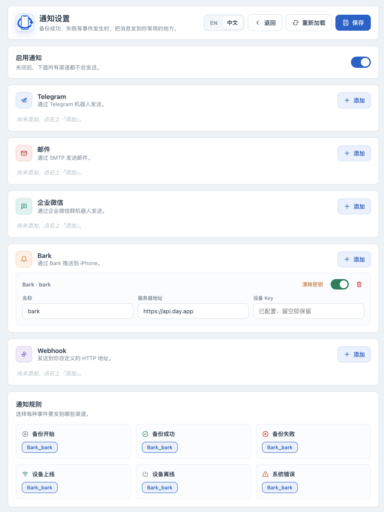
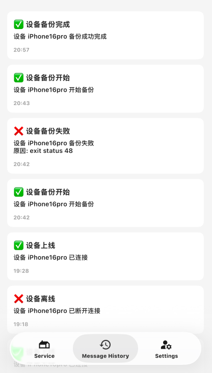

# Configure notifications and verify real events

[简体中文](notifications.zh-CN.md) · [Manual index](../OPERATIONS.md)

After configuring notifications, send a test message and check that each selected channel also receives a real backup notification. Notifications send device names, identifiers, events, timestamps and possible error text to your chosen service; confirm that recipients may receive this information. Delivery failure does not turn a completed backup into a failed backup. Notifications do not replace UI and log checks.

## Prepare

Log in using the [installation guide](installation.md) and protect default `secret_key` or your original external master key. Prepare a dedicated notification destination and credentials using the provider's current instructions. The fields, events and templates below have been checked against the current implementation. For a custom Webhook, read the [protocol and network restrictions](../WEBHOOK_GUIDE.en.md) first.

### Channel fields

| Channel | Information needed | Conditions |
|---|---|---|
| Telegram | Bot Token, Chat ID | Create a bot and receiving conversation using Telegram documentation. Messages use Markdown; inspect delivery logs if special characters cause rejection. |
| Email | SMTP host, port, username, password, sender, recipient | Port 465 uses implicit TLS; other ports attempt STARTTLS. Credentials are refused when a username is configured but STARTTLS is unavailable. Normally use an app-specific password. |
| WeCom | Group-bot Webhook URL | HTTPS is required; use current WeCom group-bot instructions. |
| Bark | Server URL, Device Key | [https://api.day.app](https://api.day.app) is the usual service address; self-hosted services share the private-target restrictions with Webhooks. |
| Webhook | URL and method; headers are available through the API | Supports POST / PUT / PATCH, with POST when empty. The current UI has no custom-header editor. |

## Add a channel, assign rules and save

1. **In the Web UI** , open Notifications and turn on “Enable notifications”. With the master switch off, no channel sends.
2. Click “Add” under the chosen channel type. Use a recognizable name unique within that type, enter its destination and credentials, and enable it.
3. Under “Notification rules”, select that channel for “Backup started”, “Backup succeeded” and “Backup failed”. Enabling a channel without assigning an event rule does not deliver that event.
4. Start with default templates; customize “Message templates” later using [body templates](#body-templates) on this page.
5. Click “Save” and confirm “Saved”. Reload and check switches, names and rules. Secret fields showing “Configured; leave blank to keep” are expected; stored secrets are not returned to the browser.



## Check test delivery, then a real event

1. In “Test”, choose “Backup succeeded” and click “Send test”. This actually sends messages to the channels assigned to that event.
2. **At the receiver** , look for the test message and verify destination and time. The UI distinguishes no matching channel, complete failure, partial delivery and success. It summarizes delivery counts; inspect the response for per-channel results and confirm receipt at each destination.
3. Check each configured destination. For failures, inspect logs and [failure branches](#when-messages-do-not-arrive) below. If necessary, use browser developer tools to inspect the per-channel results in that `/api/notifications/test` response using [test responses](#test-responses). Do not share credential or CSRF request headers.
4. **On the device page** , start one permitted real backup following [first USB backup](usb-backup.md). Confirm the start event, then the success event after completion. Do not disconnect or manufacture data errors to test failures; use the test event to validate failure-message formatting.
5. Record the date, channel names and app version of a successful check. Always inspect the actual job result when a message is missing.



## Change credentials, rename or disable delivery

Leaving an existing password, token, or other secret field blank preserves its old value. Enter a replacement, save and test again. Replacing a Webhook secret includes its URL and headers: changing the URL in the UI clears headers previously set through the API. For a channel with custom headers, provide the new URL and complete headers together through the API as described in the [Webhook reference](../WEBHOOK_GUIDE.en.md), then test. Do not replace the instance master key to rotate one channel credential.

Rules reference full notifier names: `Telegram_<name>`, `Email_<name>`, `Wecom_<name>`, `Bark_<name>`, `Webhook_<name>`. The UI generates these names. Secrets are indexed by name, so empty fields cannot inherit old secrets after a rename. To rename a channel:

1. Keep the old channel enabled, remove it from every event rule and save.
2. Change the name, re-enter credentials, assign the new name to rules and save. A Webhook with custom headers also needs its complete secrets supplied through the API.
3. Reload to check names and rules, then send a test and verify receipt. Changing only the name is insufficient.

To pause all delivery, turn off the master switch and save. To disable a channel, clear its secret or remove it:

1. Keep the channel enabled, remove it from every event rule and save.
2. Disable the channel, choose “Clear secret” or remove the entry, then save again. “Clear secret” also disables the entry.
3. Reload to verify. Stale rule references cause Save to fail, while a disabled channel may disappear from the rule selector. If this happens, re-enable it before clearing its rules. Disabling delivery does not delete backups.

## Event reference

| Event | Trigger scope |
|---|---|
| `backup_start` | Eligibility checks passed; the backup command is about to run. |
| `backup_success` | Execution completed and the final check found no attention condition; this is not device-restoration validation. |
| `backup_failed` | An admitted backup task failed. User-requested stops do not send a failure notification. |
| `backup_check_attention` | Execution succeeded but the automatic quick check found issues or could not complete. |
| `backup_history_attention` | History publication or cleanup needs attention; task recording alone does not create a historical restore point. |
| `device_online` | The app detected that a device went from offline to online. |
| `device_offline` | The device has not been detected for longer than the applicable waiting period. |
| `system_error` | Persistent connection-service failures, pairing issues requiring action, and explicit failures in restore, unpack, encryption or password storage operations. Error logs alone do not send notifications. |

A device temporarily missing, a pairing-check timeout, a locked device or pairing unsupported on the current connection updates the UI and logs without sending a push. Wi-Fi connections only validate existing pairing. To establish trust again, connect using USB, unlock the device and confirm “Trust This Computer”. Manual pairing results appear in the device's backup settings.

With automatic backups enabled, due checks must explicitly report invalid pairing at least three consecutive times over at least five minutes before sending one “Device needs pairing” warning. Successful validation resets this warning; a temporary disconnect does not rearm it. Connection services notify after three consecutive failed queries outside the startup grace period, and rearm only after successful queries spanning one minute. Deduplication is held in memory and starts afresh after application restart. The master switch, channel rules and asynchronous delivery behavior still apply.

## Notification language

Choose **Notification language** in notification settings, then save. This setting controls generated titles, default bodies, channel labels and test messages even while the browser is closed. The interface language switch only changes the page. Supported values are English (`en`) and Simplified Chinese (`zh-CN`); existing configurations without `language` continue to use Simplified Chinese.

To use the selected language's default body, leave that event's template blank. Existing nonempty templates, including Chinese text copied from an older example, are kept as custom content. Changing language never overwrites them; clear the relevant template and save to return to the built-in default. Device names and original diagnostic details are not automatically translated. Notification timestamps use the deployment timezone with an explicit UTC offset.

## Body templates

Each event can have a body template; blank uses the built-in default. Supported variables are `${title}` (built-in title), `${content}` (original body), `${device_name}`, `${device_udid}`, `${timestamp}` (RFC 3339 in the deployment timezone), `${type}`, `${level}` `${reason}` (localized failure reason) and `${diagnostics}` (original diagnostic details, when available). Unknown variables are rejected; not every event contains a device or failure reason.

```text
[${type}] ${device_name}
${content}
${timestamp}
```

Templates affect bodies across channels; other Webhook JSON fields remain intact. After editing a template, save and send a test for that event to check the body and substituted values.

## Secret storage and API checks

With the default container paths, bot tokens, SMTP passwords, WeCom URLs, Bark device keys and Webhook URLs/headers are encrypted in `/configs/secrets.enc` using the instance master key (default `/configs/secret_key`; see [configuration](configuration.md) for advanced overrides). Ordinary settings are in `/configs/notification_configs.json`. Keep the matching key and files in a protected backup; never commit real configuration to Git. Follow [instance recovery](instance-recovery.md) to prepare matching copies for migration.

GET configuration does not return secret values; `configured: true` indicates stored secrets. Run these read-only commands on the host; curl prompts for the administrator password. Adjust the port if needed:

```bash
curl --user iosbackup http://127.0.0.1:9000/api/notifications/status
curl --user iosbackup http://127.0.0.1:9000/api/notifications/config
```

Output can still disclose destination names, accounts and rules; sanitize it before sharing. Saving configuration and sending tests are mutations requiring authentication plus an `X-IOSBK-CSRF` header with the current page's `iosbk-csrf` meta value; use the UI for routine operations. `POST /api/notifications/config` saves the entire notification configuration. Sending a fragment as a patch may remove other channels or rules. See the [Webhook reference](../WEBHOOK_GUIDE.en.md) for header configuration and an example.

### Test responses

`POST /api/notifications/test` actually sends messages. Responses contain `attempted`, `succeeded`, `failed` and per-channel `deliveries`:

| HTTP status | Meaning |
|---|---|
| `200` | All attempts succeeded |
| `207` | Some attempts failed |
| `502` | All attempted deliveries failed |
| `409` | No channel was attempted |

Input errors are returned separately. Verify actual receipt and the response rather than relying only on the current UI toast. Notifications for real events enter a queue with limited capacity and are then sent in the background. Messages can be dropped when the queue is full, and shutdown can affect delivery. Pending messages are not saved persistently.

## When messages do not arrive

| Symptom | Check first | Next action |
|---|---|---|
| Test attempted no deliveries | Master switch, channel switch, selected event rule | Save and retry once; no selected notifier may return `409` |
| Only some channels fail | Actual receipt at every destination | Inspect `deliveries` or container logs and resolve individually |
| SMTP fails | Host, port, credentials, TLS and sender/recipient | Check implicit TLS on 465 or STARTTLS under [channel fields](#channel-fields); keep certificate validation |
| Webhook returns 401/403 | Receiver authentication requirements | Check URL/headers without exposing authorization values |
| Private Webhook/Bark is blocked | Destination IP, HTTPS and allowed network | Add the smallest required private CIDR using the [Webhook reference](../WEBHOOK_GUIDE.en.md), then recreate the container |
| Tests arrive but real events do not | Actual rules and whether the job really started | Requests rejected before admission do not send backup-result notifications; admitted tasks use the final-result rules |
| Secrets fail after migration | Whether the key matches `secrets.enc` | Restore the original key and matching copy; do not delete secrets as an experiment |

```bash
docker compose logs --tail=200 iosbackup
```

Sanitize reports using [troubleshooting](troubleshooting.md). Once configuration, test delivery and a real event are verified, continue with [automatic backups](scheduling.md).

## One final backup result

The start notification remains separate. After execution and the bounded automatic check finish, one final summary is sent to each selected channel. Execution, checking and history saving remain separate results. If any attention condition applies, only enabled rules for those conditions select recipients; disabling an attention rule does not fall back to a success notification. Overlapping attention rules are combined, with at most one summary per channel. Delivery remains best-effort; ambiguous sends are not replayed after a restart. Manual checks do not notify.

During upgrade, missing `backup_check_attention` and `backup_history_attention` rules inherit the existing `backup_failed` channel list once and are saved. An explicit empty list stays disabled. Both rules can be edited independently. Final-result templates can also use `${execution_result}`, `${check_result}` and `${history_result}`; empty templates use the selected notification language. If several rules select the same channel, its template follows execution failure, check attention, then history attention priority, and the built-in body contains all outcomes.
