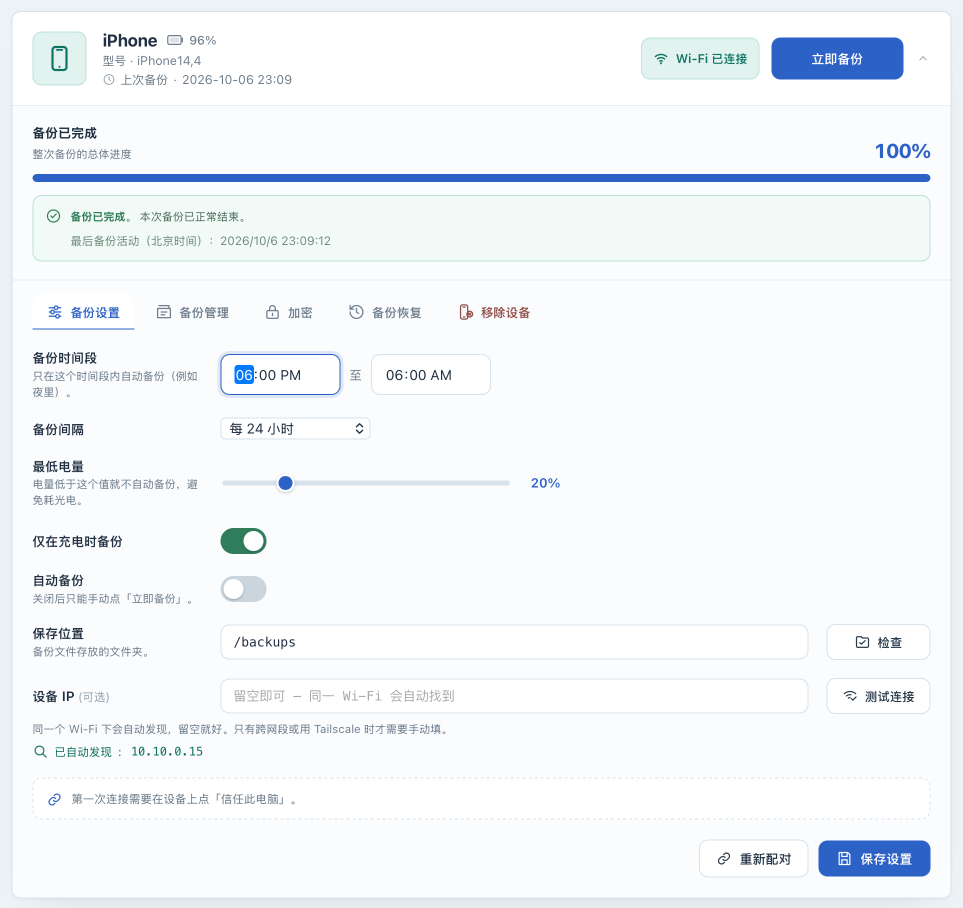
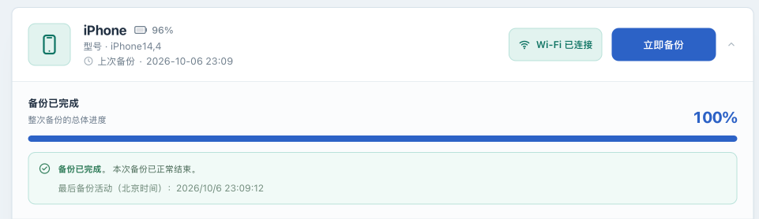

# 配置并观察自动备份

[English](scheduling.md) · [返回操作手册](../OPERATIONS.zh-CN.md)

## 目标与适用条件

为一台设备设置自动备份，并观察一次符合条件的任务从启动到结束。自动备份属于 Core；先完成[第一次 USB 备份](usb-backup.zh-CN.md)，再配置计划。通过 Wi-Fi 执行时，还须完成 [Wi-Fi 验证](wifi.zh-CN.md)。

计划决定何时尝试启动，不能保证设备在指定分钟完成备份。备份唤醒手机后，iOS 仍可能显示白色密码输入界面，按提示输入锁屏密码即可，无需提前解锁或持续亮屏；自动备份不等于无需任何人工授权。

## 操作前准备

确认目标设备在线、没有正在执行的任务、保存位置空间充足，并能在备份时段查看手机提示。记录最近一次成功备份的时间；刚完成的手动备份也会影响下一次自动备份的最早启动时间。

新设备的默认设置如下。已有设备应以界面中保存的值为准。

| 设置 | 默认值 | 含义 |
|---|---|---|
| 自动备份 | 关闭 | 打开并保存后，程序才会按计划检查并启动备份 |
| 备份时间段 | 18:00 至 06:00 | 部署时区，跨午夜；18:00 包含在内，06:00 不包含 |
| 备份间隔 | 24 小时 | 距最近一次成功备份至少经过 24 小时 |
| 最低电量 | 20% | 电量不足时不应开始备份 |
| 仅在充电时备份 | 开启 | 设备需报告正在充电 |

备份时间段使用部署 `TZ`（默认 `Asia/Shanghai`），不随浏览器时区或语言改变。更改 `TZ` 后保留已填钟点，按新时区执行，请重新核对时间窗。备份间隔按实际经过的小时数计算，夏令时切换也不改变这一规则。回拨时重复出现的钟点都可落在时间窗内，但仍受实际间隔和任务防重入约束。时间段控制新任务的启动；已启动任务不会因为到达时间段终点而自动停止。设置时请填写不同的开始和结束时间，以免弄错备份时段。

**电量与充电条件也会限制“立即备份”。** 关闭自动备份不会绕过这些条件。

## 设置一个夜间计划

1. **在 Web UI** 找到目标设备，打开“备份设置”。核对设备名称和连接方式，避免修改另一台设备。
2. 将“备份时间段”设为 `18:00` 至 `06:00`，“备份间隔”选择“每 24 小时”。这是一个夜间备份的示例；请按自己能够响应手机授权的时段调整。
3. 将“最低电量”设为 `20%`，保持“仅在充电时备份”开启。**在手机上** 接入电源，再核对设备卡片报告的充电状态。
4. 确认“保存位置”仍是已验证过的容器内目录，例如默认 `/backups`。本次设置计划时不要同时迁移备份目录。
5. 打开“自动备份”，点击“保存设置”。等待“设置已保存”提示；“有未保存的修改”消失后，设置才算保存完成。
6. 在没有活动任务时重新打开页面，核对时间段、间隔和开关仍为刚才的值。

## 观察第一次自动触发

1. **在 Web UI** 核对最近成功时间。若刚完成手动备份且间隔设为 24 小时，即使当前在窗口内也不会立即自动再备份。不要通过删除备份或修改历史时间来强制触发。
2. 在符合时间段和间隔的下一次机会，让设备保持在线、接通电源并留意手机授权提示。程序默认每 **30 秒** 检查一次是否满足条件，因此不会精确到某一秒启动。
3. 等待设备卡片进入备份状态，按手机要求完成授权。需要确认触发来源时，在部署目录查看 `docker compose logs --tail=200 iosbackup`，查找对应时间的`event=backup.scheduled`；分享日志前删除设备标识、地址和私人路径。
4. 等待页面显示“备份已完成”或失败结果。成功后核对最近备份时间更新，再按[查看备份](inspection.zh-CN.md)核对只读信息。

## 未触发、失败或需要暂停时

| 现象 | 检查与下一步 |
|---|---|
| 已过预期时间但没有任务 | 先核对部署时区窗口，再看最近成功时间、间隔、自动开关是否已保存 |
| 设备离线或已移除 | 重新连接；程序不会为已移除设备启动自动备份，按[设备管理](device-storage.zh-CN.md)处理 |
| 充电或电量条件不满足 | 连接电源、等待充电状态更新；不能把“立即备份”当作绕过条件的开关 |
| 其他任务正在执行 | 默认同一时间只能运行一个备份任务；本次检查可能跳过，条件满足时后续检查再尝试，不保证固定排队顺序 |
| 等待手机授权后失败 | 查看手机提示与[状态说明](states.zh-CN.md)，处理原因后在设备可用时重试 |
| 反复失败 | 先关闭自动备份并保存，保留现场，再按[排错指南](troubleshooting.zh-CN.md)处理；失败不会把最近成功时间改成失败时间 |

要关闭后续自动任务，在“备份设置”关闭“自动备份”并保存。这不会停止正在执行的备份；关闭浏览器也不会停止备份。

## 停止备份并暂缓自动计划

1. 在活动设备卡片点击 **“停止备份”**，阅读风险说明后确认一次：中断本次增量备份可能影响上一份备份的可恢复性。
2. 页面显示 **“正在停止…”** 时继续等待，进程和输出收束前设备仍被占用。显示 **“已停止 · 本次备份未完成”** 后才算结束；最近成功时间只是历史记录，不证明当前文件仍可恢复。
3. 保存成功后，**“自动备份已暂缓”** 会跨正常重启或升级保留，原计划不变。点击 **“手动备份一次”** 只运行一次，不解除暂缓，仍需满足电量和充电条件。
4. 准备好后点击 **“恢复自动备份”**。该操作只解除暂缓，不会打开原本关闭的自动开关。备份已到期且原条件满足时，下一轮检查就可能开始。

若暂缓状态未能保存，停止仍会执行，当前进程内也会阻止自动任务；重启后是否保留尚不能保证。处理存储问题后点击 **“重试保存”**。恢复操作保存失败时，当前进程内仍保持暂缓。

停止保留已有文件，但不回滚增量更新，也不保证上一份备份仍可恢复。重新备份属于新的协议会话。停止请求恰好晚于完成时，保留该结果并暂缓后续计划；旧任务的请求不能停止新任务。主动停止只更新页面和日志，不发失败通知；真正故障仍按通知规则处理。

重新添加已移除的设备时，会保留原来的设置。如果之前开启了自动备份，后续调度可能再次触发；移除前需要保持停用时，先关闭开关并保存。

## 下一步

为实际成功和失败事件配置[通知](notifications.zh-CN.md)，并定期[保护整个部署实例](instance-recovery.zh-CN.md)。字段范围、并发上限和调度周期的启动配置见[配置参考](configuration.zh-CN.md)。
